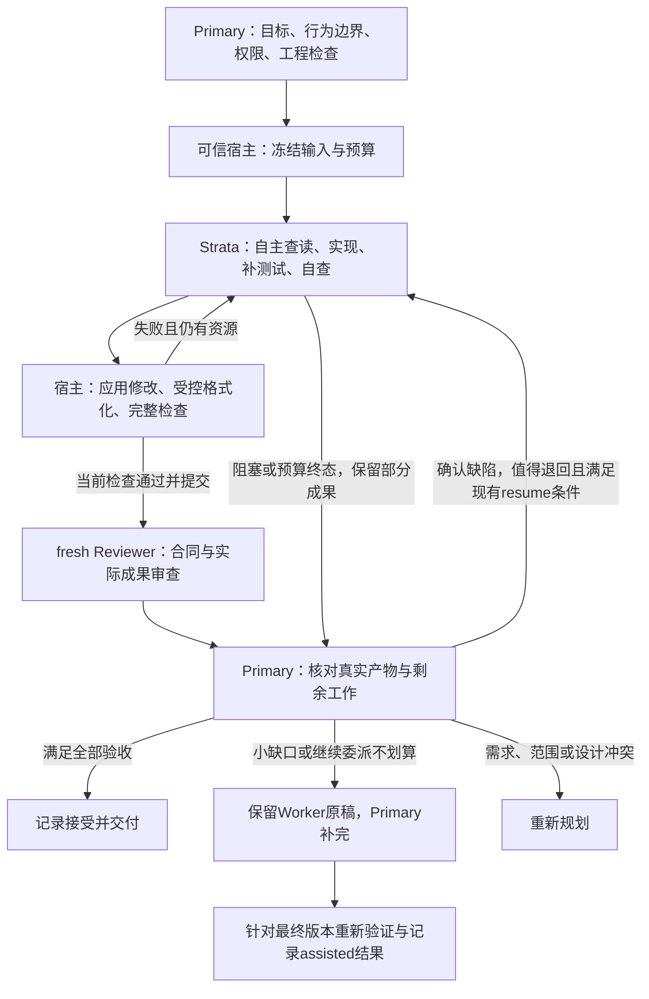

# Strata 受监督子代理架构

更新：2026-10-31。当前使用 task.34 冻结入口；这份文档规定日常协作方式，
不改变安装、模型、runtime状态、权限或历史资格。用户最新授权优先。
受监督v1的发行物和完成证据见[版本说明](strata-supervised-v1.md)；通用自主资格与受监督产品资格分开。
改写前包含既有未提交内容的原文已[逐字节保存](history/strata-design-before-supervised-handoff-20261031/snapshot.json)。

## 1. 产品目标与当前结论

Primary交付目标、真实行为约束、工作范围和验收依据；Strata自主调查、实现、补测试、
利用实际检查反馈修复，并交回可复核成果。Primary独立决定接受、退回、补完或重新规划。
产品价值是最终正确成果与Primary工作减少，允许有界本地错误与修复。

实验资格与产品价值分别记录：Worker独立未完整通过，不等于已有成果不可利用；
Primary补完后的成功也不能回填为Worker独立通过。代码或证据可复用，必须通过实际审查确认。
不按代码行数估算“完成百分比”，一个很小的错误也可能影响整个不变量。

最新[真实源码试用](../benchmarks/work/subagent-handoff-pilot-20261031-1/report.md)：
Worker完成JSON深层校验及15项补测，登记检查和fresh Reviewer通过；Primary独立35项行为检查通过。
额外Pyright发现一处类型标注错误，Primary保留原稿，在独立副本改两行后完整验证通过。
canonical仍为takeover、最终为assisted。证明成果可用，尚未证明净云成本节省或一般任务完成率。

当前可作有限、受监督的可信Python工程试用；通用自主版本和完整调查门槛仍HOLD。
[稳定性增量](strata-supervised-stability-update.md)与各批decision提供实际资格；旧失败、未运行和辅助成绩不改写。

## 2. 一名执行子代理，可信宿主，独立终验

只读investigate走“自主取证→报告→Primary”，没有正式编码Reviewer。部分失败终态也会进入Primary处置，
但不能由此假定它符合resume条件。上述箭头是职责与决策，不是新增runtime状态。

|层|负责|关键边界|
|---|---|---|
|Primary|意图、风险、行为完整单元、权限、工程检查、缺陷处置、集成与最终验收|观察实际diff/检查；不替Worker提前写完整算法，不把辅助结果记成自主成绩|
|Strata执行者|批准范围内决定读什么、如何实现、补什么测试、怎样修复|不能自行扩权限、改保护输入、改变合同或验收标准|
|可信宿主|当前源码与版本绑定、编辑事务、自动检查、预算、状态、不可变归档|验证机械事实；不宣称语义正确、不替模型选算法|
|fresh Reviewer|独立上下文审查合同、实际源码/diff与检查事实|只读、不执行、不授予返工或最终接受；同一iq3_s仍可能共享误解|

当前不是完整Strata默认工具环境：NativeAgent会话/工具循环连接Python宿主。
实现工具为kit_read/search/propose/submit/block；自动验证由宿主执行。Explorer能力已在执行者内部，
没有必要为每个任务再跑一个Explorer。当前链没有Coordinator；未来应证明其减少任务准备成本，再考虑引入。

## 3. 任务合同与准备成本

任务单位应是一个行为完整的改动，可覆盖相关源码和补充测试；原子不变量不能被拆低风险。
Primary说明外部可观察目标、需要保留的行为、重要错误/边界、批准输入/写范围、风险和验收。
已知符号作为导航；具体数据结构、局部步骤、测试组织由Worker选择。
实现引用须用实际支持的函数/方法等符号，不能将整个class当作当前implementation_ref。

检查配置优先复用目标工程现有测试、formatter、lint和typecheck。适配切片时逐项明确保留、
缩小范围或不适用的原因；不得默认忽略Pyright。没有映射的项目检查要在运行前可见。
Ruff检查显式--no-fix，格式检查--check；格式化是单独受控操作。记录解释器、导入来源和检查覆盖的输入。

日常任务不要求完整参考实现、新runner或逐行操作剧本。只补缺失的关键验收；模型自编测试也是待审产物。
保护输入/隐藏验收不进入修复提示；真正新增需求单独决定，不能在终验中追着草稿扩合同。
只读范围应覆盖必要依赖和调用方；写权限保持任务相关。范围外缺证据当前只能blocked，不能让模型猜。

## 4. 自主循环与预算

已实现：读取/搜索→有效提案→宿主格式化/完整检查→反馈→在额度内继续修复；提交后fresh Reviewer。
一次任务不是一次LLM调用。每次有效修改都使旧检查失效，交付绑定当前全部相关输入。
no-op、无新证据循环、协议纠错、时间与资源上限继续约束执行；不能用反复抽样获取PASS。

新编码试用的task-rework-v1保持首段16请求/4编辑，一次封存返工14/4；每段有对应写后检查机会。
Reviewer每次最多10请求，最多两次不同代码审查，完整provider上限50。首段1800秒、返工900秒、
Reviewer每次900秒，均不是含加载/准备/人工的端到端承诺。只读任务采用自己的预算。
全部参数以[操作说明](strata-supervised-usage.md)和冻结合同为准；本设计不合并额度池或升级旧任务。

## 5. Primary如何决定继续、接受或接手

先核对当前产物、确切失败和原任务，再判断剩余工作与协调成本。不存在按代码行数或“已完成七八成”自动接受。

|真实观察|日常处理|当前支持情况|
|---|---|---|
|当前完整验收成立|记录accept，集成交付|编码仍要求匹配的fresh审查/检查；调查由Primary独立核对|
|在域缺陷清楚、仍有实质工作适合本地完成|提供事实反馈，原任务内续作|仅当已选profile和canonical状态允许；Reviewer-origin逐项处置；Primary-origin要求clean fresh PASS|
|小且明确的缺口，或继续本地协调成本更高|Primary保留草稿，在独立副本补完并重验|已实测；原稿记录takeover，最终标assisted|
|未完成但已有可信定位、测试或实现|明确可复用部分与不可靠部分，决定补完或重规划|不能让partial冒充ready/accept；按实际终态检查能否记录原稿处置|
|报告附加断言不可靠，核心成果可独立核实|Primary纠正整合，保留原报告问题|不因报告修改自动撤销正确代码，也不将整合结果回填为原报告通过|
|范围、合同、依赖或设计不明确|replan并记录需求/权限决定|不由模型或skill自行批准|
|不安全行为、产物漂移或重复无进展|停止本地尝试，检查并接手/重新规划|不通过换身份或删除账本恢复额度|

完整接手顺序：等待任务settled并确认无活动writer；保留原canonical结果/源码/检查；记录处置；
从已核对的草稿建立独立工作副本；只修确切缺口；对最终版本重跑所需工程与独立检查；记录Primary实际改动。
原Reviewer PASS只覆盖旧快照，不能声称它审查了Primary修改后的文件。Primary完成后承担最终版本审查责任。
本轮实验使用副本，不自动把成果应用到兄弟仓库或真实项目。

当前resume不是任意会话追问。task-rework-v1首段失败不能自动使用封存额；普通只读报告不完整
也没有可临时启用的同任务语义续问入口。已存在的`task-v1`调查续作必须在新任务启动前明确选择，
允许一次绑定原合同的证据核实，共享原预算；不能给旧独立调查原地切profile。
已存在诊断/兼容profile不等于本入口可随时切换。
这些是已实现的策略边界；若它们阻挡有价值恢复，先保存状态/剩余额度/所需动作，再另做一个窄候选。
[返工准备工具](strata-primary-return-preparation.md)帮助绑定hash和引用，不能授予不满足条件的resume。

## 6. 上下文、事实状态与交接

任务事实由宿主保存：原目标/约束、当前源码和diff、检查版本与结果、预算、失败/修复和派工身份。
模型自己的总结可用作导航，不取代这些事实。每次继续都核对当前版本，防止验证旧代码或遗漏已知失败。

当前上下文在原生循环内累积；有界重建保留任务、当前事实和最近完整工具回合，完整历史仍归档。
最多两次重建，第二次须有新有效编辑。它不保证模型重读了完整历史或保留所有语义推导。
Primary能读完整档案，不意味着必须每次把全部轨迹装入云上下文：先读结果索引，再按风险看实际diff、
失败检查和关键源码。疑点追到原始请求/响应；超长管理文档不作为Worker任务正文。

交接应提供的内容是“当前产物、真实检查、未解决点、已知限制、可用证据路径”。
优先复用现有result/ledger/diff/检查材料；本轮不增加模型必填JSON字段或改成功协议。
部分成果应诚实可读，不要求它先拥有PASS才允许Primary利用。

## 7. Skill与能力分层

|内容|应该放在哪里|
|---|---|
|权限、预算、版本/检查绑定、禁止操作|可信宿主和任务配置，不能依赖skill保证|
|当前工具参数与必要输出形状|真实tool schema与短核心协议，启动时可见|
|本次目标、事实来源、验收与范围|任务合同；不写入全局skill|
|可复用调查/恢复/交接方法|可选skill；按任务选择，记录加载内容hash和成本|
|长实验历史、注册、成绩、内部实现计划|Primary研发档案，不注入Worker|

[source-backed-handoff](../strata-skills/source-backed-handoff/SKILL.md)保持0.1.1显式可选，
不因本轮重新审视架构追加提示。三题配对确认完整加载，却未显示准确率收益，且请求和输出增加。
任务本身明确要求推导是共同条件，不能据此宣称skill有害或解决旧缺答。
当前只有investigate支持approved_skills，编码拒绝非空技能列表；UI安装与独立Worker加载不同。
详见[加载说明与实测](strata-skill-manual-loading.md)。

Primary的选择与传递规则放在[技能目录](strata-skill-selection.md)，由本仓库AGENTS.md引导读取。
通常零个或一个，按所需方法选择；提供给Worker的是获准技能目录，完整正文按需加载。
行为追踪和结构化数据核对各有一个新专项候选。前者一次加载实测报告含语义错误；后者在ZIP安装后的新切片任务正确接受。
两者均未证明提高准确率，不替换既有任务输入或扩大资格。
这是同一执行者的任务配置，不新增角色。编码及自动Reviewer的技能传递仍未接通。

|能力|当前边界|
|---|---|
|读取/搜索/实现/补测|批准文件清单内；具体写入仍受冻结编辑器约束|
|验证|宿主配置好的工程检查；Worker不能执行任意shell|
|网络|显式公共上下文、批准host/entry；当前可写实现合同拒绝web|
|操作/脚本|已有固定json-summary操作，不是任意脚本权限|
|子任务|显式只读子集与共享预算，无更深递归；不等于Coordinator分解资格|
|能力组合|continuation与可选capabilities/native-tools试验组合当前拒绝；不能由单项成功推及组合|

保持iq3_s单驻留；当前连接/资格绑定该模型及模板。模型选择与任务政策逻辑应分层，
但不因此宣布当前实现可无验证切换任意模型。工具白名单不是OS隔离，工程检查会执行可信项目代码。

当前task.34能力复核见[capability-refresh](../benchmarks/work/capability-refresh-20261031-1/report.md)：
真实web+固定operation正确接受，真实只读孩子/父回读路径可用但报告有无依据的对象身份结论，保留HOLD。
这扩大了当前工具路径的实证，不将父子一致视为语义正确或认证更多组合。

## 8. 产品面、评价与演进

产品入口保持prepare/run/status/resume/cancel和create-only成果导出。
底层继续复用编辑器、校验、canonical档案与NativeAgent；暂无证据要求换整套harness。
任何封装先减少Primary重复输入和读取，不能偷偷改变接受权、权限或账本。

每次至少分开记录：Worker原终态/独立验收、可复用产物、Primary反馈与改动、最终版本验收。
同时记录真实请求/编辑/no-op/纠错、检查/审查/加载耗时；Primary准备、定位、语义提示、协调、
终验和代写分别说明。可测就测，不可测写unknown；weekly用作停止线，不推算精确token或节省比例。

一次性harness研发与每任务准备成本分开。优先观察是否复用了完整实现/测试、是否减少了Primary重复工作，
同时承认审查与准备负担。通用资格HOLD和受监督单任务有用可以同时成立，二者不相互改分。

当前下一步见[唯一行动计划](strata-supervised-next-step.md)：先完善工程检查映射与交接，
再用有限新任务检验协作。若暴露机械阻碍，只改被证据支持的边界；普通语义失败先按上表处置。
源码核对依据：发布包中的task_contract.py、task_workflow.py、task_continuation.py、
review_rework_budget.py、general_return.py、general_context.mjs，以及最新真实请求/decision。
