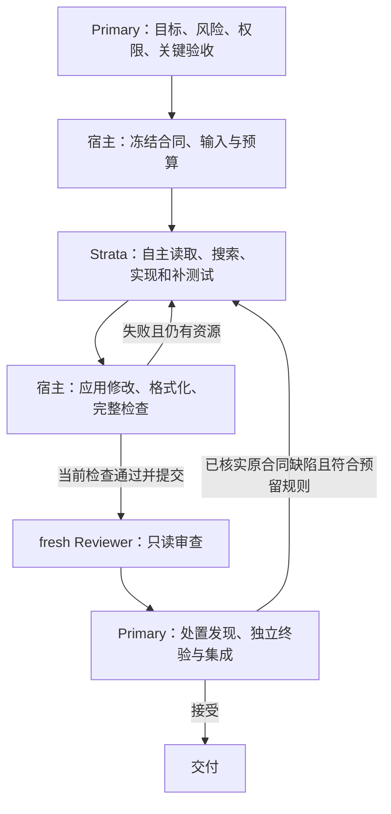

# Strata 受监督子代理：当前架构与设计约束

更新：2026-10-30。本文件是当前设计入口，区分已实现行为、证据边界与演进建议。
本文描述设计；隔离候选的具体修改、注册和结果另见当前行动计划，不改变生产默认
或历史成绩，也不以本文代替live前的任务冻结和预算登记。
用户最新指令决定授权；源码和实际执行证据决定行为；设计目标不代替资格。

## 1. 产品目标与当前资格

目标：Primary 主要负责目标、权限、关键验收和集成；本地 Worker 自主完成获准单元
中的调查、实现、补测试和有界修复。允许普通错误与 retry，以最终独立接受、错误
放行控制和 Primary 重复工作量评价价值，不以一次成功率或本地 token 数代替目标。

当前新隔离编码试用选择task.34：629项宿主控制、安装验证及正确绑定后的已暴露
生命周期实现完整链接受；同安装连续执行/拒绝重复派发/旧档案不变通过。后续调查
原报告有正常完成和after hook过度延伸，整体回答门槛HOLD，Primary纠正另列；
不因此放行通用调查或整体通用版。task.34仅提前拒绝已有类implementation_ref，
不增加class PASS、权限、提示或预算。具体包与边界以操作说明为准。
上一冻结候选task.33：620项宿主控制、安装验证及一格同版本
实际测试修复完整链通过。它继承task.31的模型侧行为，只加强Primary接受记录与当前
输入/检查/真实fresh审查的绑定，不声称模型语义能力升级，也不改变生产默认。
旧task.31真实档案因安装哈希不同被新候选正确拒绝，未绕过重绑；历史接受事实保留。
此前操作说明推荐 task.24 的显式受监督编码候选，限已记录任务族；具体安装来源、
条件返工与配置以[受监督使用入口](strata-supervised-usage.md)为准。task.22 是其
历史窄资格证据，不应误写为当前操作说明的推荐版本。更晚的 task.27/task.28 是
隔离研究候选，尚不能因为编号更高就替代已记录的受监督资格或生产默认。

task.21已验证Reviewer重复检查材料投影；task.22进一步在失败写后自动显示有界
当前源码。539项同版本控制通过。20261029固定迁移批次中，工具定义筛选、Hook
identity移除/运行快照两格依原冻结验收完整接受（分别438/439项）；后一格自主
修复自编测试/静态错误，无Primary修法或代写。原20261028因Primary随机UUID验收
夹具错误而HOLD的批次及纠正后同产物验收分别保持，不因后续结果改写。

这不是通用调查、未知项目、无人值守自动接受或所有能力组合的生产资格。2026-10-30
真实采样窗口对照中，两份通过项目检查并获Reviewer PASS的草稿均未通过Primary
独立边界检查，一次辅助返工也未通过；完整事实见[批次交接](../benchmarks/work/harness-convergence/strata-window-repair-transfer-20261030-1/handoff.md)。
该结果不推翻过去窄任务的验收，也不能外推为模型普遍无能力；它说明当前 Reviewer
和检查覆盖不能替代风险相称的独立验收。净云成本节约仍未测量。

任务合同应写清真实支持的输入域和兼容边界，尤其是“所有对象”“可用偏移”等宽泛
措辞是否包含用户实际需要的子类、第三方扩展和无效对象。Primary 在启动前根据
需求和风险冻结必须满足的情况；独立验收仍可发现已登记合同内的遗漏，但后发现
的范围外假设只能作为诊断或新的需求决定，不能追着草稿无限扩展合同。适配器
时间任务的事后反例和宽合同评估见[批次交接](../benchmarks/work/harness-convergence/strata-adapter-time-transfer-20261030-1/handoff.md)。

| 文档/记录 | 用途 |
| --- | --- |
| 本文件 | 当前职责、不可放宽的边界、设计取舍 |
| [受监督使用入口](strata-supervised-usage.md) | 冻结安装来源、真实 CLI、配置与预算 |
| [下一阶段](strata-supervised-next-step.md) | 唯一当前行动计划及成功/失败分支 |
| [执行记录](strata-practical-readiness-progress.md) | 最新结果索引与带日期的历史快照 |
| [既有完整资格计划](strata-practical-readiness-plan.md) | 仍未补齐的通用资格门槛；不自动重开旧批次 |
| [task.22新迁移decision](../benchmarks/work/harness-convergence/strata-qualified-transfer-20261029-1/decision.json) | 当前冻结构建的窄受监督资格；原始两格结果及限制 |
| [task.20 decision](../benchmarks/work/harness-convergence/strata-full-task-return-20261028-1/decision.json) | 先前基线的实际结果与限定资格，不能被设计文档改分 |

证据锚点：task.20 的 520 项宿主控制通过；固定两格分别是已暴露且 Primary 事实辅助
的返工、新 AgentRegistry.unregister 正常任务，各独立 429 项通过，均有自编测试错误
的本地自修。两格含重叠回归，不能相加。旧 awaitable 任务检查绿、Reviewer PASS、
Primary 拒绝的语义漏检，以及旧调查 HOLD 均保持。详见
[完整交接](../benchmarks/work/harness-convergence/strata-full-task-return-20261028-1/handoff.md)。

## 2. 一个执行代理，一个可信宿主，独立验收

后续实际异步输出mapper新任务族原尝试与一次辅助窄修复均未接受，不能外推原窄
资格。合法generator awaitable仍未实现，检查正确拒绝，Reviewer未运行。16项离线
表示控制不能证明格式兼容会修复语义；最后冲突重叠必须拒绝。没有据此改runtime、
扩预算或替换架构，见[阶段证据](../benchmarks/work/harness-convergence/strata-practical-async-output-repair-20261029-1/handoff.md)。

| 层 | 拥有的职责 | 不拥有的权力 |
| --- | --- | --- |
| Primary | 意图、风险、完整行为单元、来源/写入权限、检查政策、真实缺陷处置、最终接受与 Git | 不把未执行/辅助结果记成自主成功，不事后改门槛 |
| 任务入口与可信宿主 | 合同编译、版本绑定、编辑事务、检查、账本、停止、不可变证据、审查快照 | 不替模型选择算法或宣称语义完成，不自行扩大权限 |
| Strata Worker | 在批准范围内选择步骤、查证依赖、实现、补充测试、根据真实反馈修复 | 不决定权限、预算、保护测试或自身验收标准 |
| fresh Reviewer | 读取实际合同、源码/diff和宿主检查，提出证据支持的缺陷或交付建议 | 不执行任意命令、改代码、授予续作或最终接受 |

当前原生 AgentLoop、会话及工具组件通过桥接调用 Python 宿主；不是完整加载 Strata
默认产品 profile 或所有原生工具。编码实际工具是 kit_read、kit_search、kit_propose、
kit_submit、kit_block。宿主自动检查，模型不再执行 VALIDATE/FINISH 成功确认协议。

Explorer所代表的读取、搜索和定位职责已包含在实现Worker内部，当前编码链没有
独立Explorer调用。独立investigate任务有单独的报告正确性资格。当前链没有
Coordinator；不能用 Worker
自主读取或两个单元串联成功，推断已具备从宽泛计划生成可靠工作包的能力。

## 3. 合同只规定结果和边界

一个任务应覆盖行为完整的工作单元，保持原子不变量；不是任意一次修改，也不直接
把整个项目交给 Worker。复杂度和风险分别记录：代码短不表示风险低，拆分不降低
兼容、并发、事务等不变量的风险下限。当前写入上限以安装版本的校验为准。

Primary 必须提供目标、可观察行为、正常/异常/重要边界、批准来源和写入范围、
稳定符号锚点、保护检查及可写补充测试。已知锚点用于导航，不给逐行算法或编辑顺序。
若任务确有顺序不变量，应明确表达。Worker可选择任何满足合同的在域实现。

Worker新增测试同样会成为交付的一部分：测试通过并不证明它只约束已批准的需求。
Primary与Reviewer应检查其断言是否把明确排除或尚未决定的行为固化为回归要求；
如发现此类约束，应依据原合同处置，不能仅凭实现和测试同时为绿就接受。一次
已暴露诊断中，Worker添加了独立CR行为断言，Reviewer称未引入该要求；隔离反例
证实它会拒绝合同范围外的行为变化，完整交付被拒绝。见[诊断记录](../benchmarks/work/harness-convergence/strata-create-scope-20261030-1/handoff.md)。
这不意味着所有额外测试都无效：在域的兼容保护和明确授权的边界测试仍有价值。

高风险单元由Primary逐项审查新测试的关键断言及其合同依据，包括错误类型之外的
消息文本、顺序、时序和合同明确排除的输入；已有行为是否属于必须保留的兼容面，
也要对照原任务与原始实现判断。引用与检查结果只能证明来源和观察，不能自动证明
该断言被授权。近期有限超时案例中，Reviewer与Primary均曾漏掉消息文本约束，
后来通过合法反例追加更正；同一聚焦只读调查能识别该消息问题，但仍漏判另一项
独立CR约束，因此不能自动用它代替Primary审查。原始动作记录显示Reviewer确实
完整读取两份测试；SSE报告检查了测试是否符合当前实现，却没有正确识别断言超出
合同，不能简单把漏检归因为读不到文件。详见[追加更正](../benchmarks/work/harness-convergence/strata-create-finite-20261030-1/decision-addendum.json)与[跨案例对照](../benchmarks/work/harness-convergence/strata-test-contract-review-sse-20261030-1/handoff.md)。

日常准备优先复用已有工程配置与检查，只补缺失的关键独立验收。不要求为每道任务
先写完整参考实现、专用 runner 或详尽操作剧本。正式 benchmark/已注册控制若要求
参考解，继续遵守原登记；不能借“减少准备”删除原门槛或让隐藏答案进入修复反馈。

批准的只读材料应覆盖真实依赖和调用方；没有必要把读范围缩成写文件。宿主当前按
冻结清单读取，缺少范围外证据只能 blocked 交 Primary。不得静默增补输入或强迫模型
猜测；若修改合同/范围，应记录修订及介入，旧结果不变。这是现有边界，不是新增权限。

## 4. 恢复以宿主事实为依据，首轮与返工明确区分

完整参数以[使用说明](strata-supervised-usage.md)和冻结账本为准。新受监督编码试用
预先选择 task.22 的 task-rework-v1：首轮 16 请求/4 有效修改，封存一次 14/4；
整任务最多 30/8。每次有效修改都配有完整写后检查机会，安全和总时间停止优先。
Reviewer 每次独立预算，最多两次不同代码上下文；30/8不是全链 provider 总额。

| 观察到的情况 | 当前合法处理 |
| --- | --- |
| 普通测试/静态错误，阶段仍有额度 | Worker在原任务内自主读、改、全检查；无需Primary每步解释 |
| 无效编辑、截断或协议错误 | 使用原有有界纠错，分别计数；不算一次有效实现或免费请求 |
| 首轮未交付/预算耗尽 | 保留失败和草稿；task-rework-v1不能借用封存返工额度 |
| fresh Reviewer提出rework | Primary核对canonical每项finding；仅确认的原合同缺陷进入一次预留返工 |
| Reviewer干净PASS且无findings，Primary发现缺陷 | 绑定前次result、当前source/check和原合同证据，使用一次预留返工 |
| 报告不完整、合同冲突、缺权限或新需求 | 如实阻塞/重新规划；不是自动续作，也不冒充Reviewer finding |
| 返工后没有实改，或输入与检查不匹配 | 不重新抽相同审查，不接受；保留当前结果 |

首轮未用余额不扩大返工上限；旧任务不能升级profile或重置账本。上述 clean PASS
要求及首轮失败不得借预留是已实现设计取舍，不应包装成“所有失败都能继续30次”。
若后续明确阻挡有价值恢复，先记录轨迹和剩余资源，再单独比较一个窄策略候选。

Primary只给可核实缺陷事实，也必须记录介入；已有批次标为assisted的事实反馈保持
assisted，不能因未给代码改成自主成功。额外算法、新语义解释、人工定位和代写分项
记录。预算允许普通自修，不允许对同代码和同证据反复抽Reviewer直到PASS。

## 5. 上下文由事实状态维持，不要求模型记住全部流程

宿主保存合同、版本、当前diff、真实检查、已观察源码和有界近期证据，完整历史
仍可供Primary读取。当前采用确定性上下文重建，最多两次，第二次须有新有效修改。
恢复不增加预算，也不让模型摘要成为权限、检查或成功事实。

这能保留执行事实，不能保证早先推理中的依赖关系始终被模型理解。当前120行读取、
10条搜索结果和来源清单限制均真实存在；上下文重建或局部重读被拒要记录实际影响。
实验管理文档很长，不等于模型看到同样长的输入；需要核对真实request才能归因。

当前不新增摘要模型或复杂记忆平台。先记录缺失证据、重复读取、重建次数与失败
位置；只有事实表明重要已获证据丢失，才窄改其呈现。不得注入成功补丁、隐藏答案
或推测性“已解决”状态。总token用来诊断负担，不直接用作本地经济评分。

2026-10-28补充证据：正式Hook单元中，模型完成实现及本地自修，但Reviewer两个
机械报告错误后第二次重建被“无新编辑”停止；只读角色剩余1请求/约670秒不能用。
旧结果[HOLD0/1](../benchmarks/work/harness-convergence/strata-formal-project-unit-20261028-1/decision.json)
保持，437项仅为实现诊断。首次Reviewer输入中重复检查材料约占50K字符；候选
task.21复用既有事实投影，把同一初始请求29435降至8264 tokens，0模型计数。
这给出了先压缩冗余输入的具体依据；不证明原报告会纠正，也不放宽重建或引用门槛。
候选资格待其同版本回归与新注册live结论，不能用输入减少量当成功率提升。

后续task.21新模型耗尽任务完整接受435项；不同跨源码包装器仍因写后当前源码读取
额度不足HOLD：11请求/1改/16证据，剩5请求/3改/3检查，真实静态/自编测试错误未修。
这支持继续区分模型错误与恢复通道。独立[写后反馈阶段](strata-postwrite-feedback-plan.md)
只返回当前失败检查定位的有界获准源片段，自动展示量单列，显式预算与门槛保持。
增加可见事实的效果须独立验证，不能归为同信息量下的模型能力提升或旧任务成功。

## 6. 正确性分层，不让同模型审查成为唯一保证

机械门槛保证来源/权限/当前检查等可核实事实；工程测试覆盖已表达的行为；Reviewer
提供新的语义检查；Primary负责独立关键验收及风险相称的集成判断。四层分别报告。

Coder与Reviewer串行使用同一iq3_s，fresh指上下文和证据隔离，不是不同模型或统计
独立。awaitable历史已证明二者可能共享误解。Worker自编测试同样可能编码同一种
误解，所以不能替代保护测试或独立验收。

保留Reviewer语义漏检、误拒、证据不足和协议失败；Reviewer PASS不等于最终正确。
Primary发现并拦截的漏检记录为Reviewer误放/终验拒绝，不能写成最终错误接受。
如果独立检查仍不足，单列覆盖与审查问题，不以增加Coder请求掩盖。
当前不取消fresh Reviewer，也不降低风险来制造Primary成本下降。

## 7. 能力按合同启用，组合仍需证据

| 能力 | 当前实现/组合边界 |
| --- | --- |
| 编码与补测试 | 已有窄受监督证据；受写入清单、工程检查和Primary接受约束 |
| 只读调查 | 有独立入口与部分资格，完整调查迁移门槛仍未取得 |
| Skill | approved_skills目前只支持只读任务；界面加载不证明某次编码请求使用了skill |
| 网络 | 显式公共上下文、批准host/entry；可写实现合同拒绝web |
| 脚本/操作 | 当前为固定json-summary操作，不是任意shell/Python执行工具 |
| 子任务 | 显式父任务只读子集、共享预算、无更深递归；不是Coordinator拆解资格 |
| 能力与返工组合 | 当前continuation拒绝可选capabilities/native-tools试验组合 |

工具允许清单不是OS沙箱。项目检查会以宿主进程权限执行项目和Worker测试；当前
只用于可信本地项目。未知代码执行、联网与写入组合或任意脚本属于重大信任边界
变更，须单独设计和授权，不能从一个开关或一次成功推导安全性。

保持iq3_s与单模型驻留。已验证是同一实例串行工作、请求前后核对及实验锁，不是
控制机器上所有应用的全局原子切换器。模型/执行策略解耦是设计目标；当前代码和
资格仍绑定实际iq3_s、协议和配置，更换模型不自动继承结果。本阶段不更换后端。

## 8. 产品面收敛与代码分层方向

日常操作只面对一个冻结安装来源、strata-task prepare/run/status/resume入口和一个
预先选定的受监督策略。旧普通16/4与兼容profile保持可用，但不把全部历史选项变成
新用户必须选择的菜单。文档推荐不等于修改生产默认或给旧安装增加能力。

实验适配、reference、负控与注册属于研发层；它们不能成为每个真实任务的必需脚本。
完整输出归档可读，Primary先读事实索引，再按风险读取实际diff/证据，避免重复把
整份轨迹送入云上下文。不能为了摘要简洁丢掉失败、缺口或辅助标记。

当前GeneralHost仍继承旧WorkerRuntime，复用编辑、检查、归档；不重新fork另一套。
未来确有维护/回归证据时，逐个提取明确接口：

- 推理/原生会话：请求、工具调用与用量事实，不拥有验收权限。
- 可信工作区服务：读取、版本绑定编辑、完整检查和证据快照。
- 任务政策：范围、预算、停止、返工和审查路由。
- 产品入口：合同编译、事实结果索引和操作指引。

这是演进方向，不是当前已经完成的重构或本轮重写授权。新profile须有旧机制不能
表达的实测理由，并说明兼容范围及以后如何归并；不为每次失败永久叠加特例。

Coordinator只有在Primary反复承担拆分/依赖整理已成为明确成本时才值得引入。
届时必须验证“批准计划→正确行为单元、合同、依赖、风险、验收材料”的质量，
同时证明减少Primary准备，而不只验证调度。无需为角色齐全提前增加它。

## 9. 价值评价与变更纪律

分别记录一次性harness研发/实验准备，以及每任务反复发生的合同与关键验收准备、
定位、协调、语义反馈、终验、接管。没有Primary代写不等于Primary工作少。
已有工具能提供的请求、编辑、no-op、协议恢复、检查/审查/执行耗时和token照实记录；
主动时间或精确云用量拿不到则写unknown，weekly used只作停止线。

先评价工作是否转移和哪些步骤仍需Primary。没有Primary-only配对与完整用量，
不报净节省百分比；日常试用不为测成本另造平台。task.20的594.546秒只含两格任务
窗口，不含准备、独立验收及Primary，不能称用户端到端总耗时。

当前下一步是[正式入口的中等真实单元](strata-supervised-next-step.md)。保持候选、
安全与正确性门槛；普通失败按类别分析。确认机械bug才离线窄修；语义错误不自动
修改harness；设计矛盾才单列策略对照。关闭批次、失败分母和辅助成绩不覆盖。
旧完整资格未达标继续HOLD；文档收敛和一次试用不能宣布通用稳定或发布新版本。
